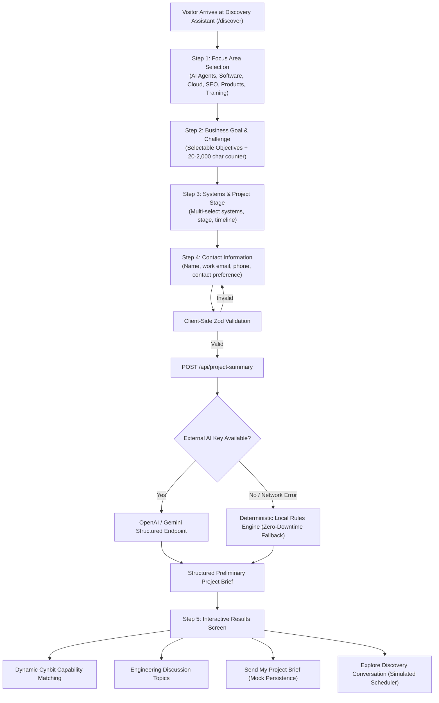

# Technical Engineering Report: Cynbit Project Discovery Assistant

**Project:** Cynbit Project Discovery Assistant  
**Target Organization:** Cynbit Technologies ([cynbit.in](https://www.cynbit.in/))  
**Date:** October 2026  
**Document Type:** Architecture & Implementation Technical Report  
**Author:** Senior Full-Stack Engineer & Product Designer  

---

## 1. Executive Summary

This report documents the architectural audit of Cynbit Technologies' web presence and the design, engineering, and verification of a high-impact solution: the **Cynbit Project Discovery Assistant**.

Cynbit Technologies positions itself as an engineering hub specializing in **Autonomous AI Agents**, **Enterprise Software Development**, and **Cloud Infrastructure Modernization**. However, an audit of their production site revealed a significant conversion and credibility gap: prospective clients are greeted by static brochureware with a passive contact form requiring them to draft technical specifications into an empty text box. Furthermore, the live form suffered from a critical server-side rendering (SSR) bug where the markup is outputted with `style="opacity: 0"`, risking complete form invisibility if client JavaScript hydration stalls.

To resolve this, we engineered a production-grade prototype: a 5-step guided technical discovery assistant built with **Next.js 14 (App Router)**, **TypeScript**, **Tailwind CSS**, and **Zod**, featuring:
1. **Interactive Needs & Context Scaffolding:** Eliminating blank-page syndrome for prospective clients.
2. **Deterministic & Grounded AI Summarization:** Producing structured, preliminary engineering briefs without unverified timelines or ROI promises.
3. **Progressive Enhancement Direct Form:** A resilient fallback contact form guaranteed to render visible on initial server render (`opacity: 1`) and function with or without client JavaScript.
4. **Data Privacy by Design:** Stripping personal identifiers (PII) from local development logs and cleanly delineating prototype mocks from persistent storage.

---

## 2. Problem Statement & Site Audit

### 2.1 The "Show, Don't Just Tell" Gap
Cynbit’s marketing headlines emphasize *"Autonomous AI agents & cognitive automation"* and *"The speed of a startup, the rigor of an enterprise"*. Despite this, an enterprise buyer, CTO, or founder visiting the site experiences zero active demonstration of AI automation. The sole method to engage is a standard contact page with a blank textarea and a promise of a *"24 H Response Sync"*.

### 2.2 Forensic Inspection of `https://cynbit.in/contact`
Through direct HTTP inspection and JavaScript bundle analysis, several critical friction points and technical vulnerabilities were identified:

```
[Production Site Vulnerability: cynbit.in/contact]

1. SSR Flash of Invisible Content (FOIC)
   Raw HTML output:
   <form class="space-y-6" style="opacity:0">
   └── Framer Motion initial={{ opacity: 0 }} injected inline into server HTML.
       If client JS hydration is delayed, blocked, or fails, the form remains invisible.

2. Blank Canvas Cognitive Friction
   Form Input: "How can we help you architect your next chapter?"
   └── Forces non-technical operators to guess software architecture terminology.

3. Monolithic Error State
   Client chunk disassembly:
   r.success ? i(!0) : n("Something went wrong. Please try again or email us directly.");
   └── Zero field-level validation feedback or recovery guidance.

4. Delayed Gratification
   "24 H Response Sync"
   └── Leads cool down; often requires back-and-forth emails before speaking to an engineer.
```

---

## 3. Technical Stack Selection

The stack was chosen to reflect modern enterprise standards, ensure high performance, and resolve the specific technical shortcomings discovered on the live site:

| Technology | Selection Rationale | Role in Prototype |
| :--- | :--- | :--- |
| **Next.js 14 (App Router)** | Industry standard for React applications; provides React Server Components (RSC) and Server Actions. | Hosts page routes, streaming endpoints, and handles server-side form submissions. |
| **TypeScript 5.6** | Static typing prevents runtime contract mismatches between client forms, API routes, and summary parsers. | Full data modeling for discovery states, enums, and API payloads. |
| **Tailwind CSS 3.4** | Utility-first, zero-runtime overhead CSS; enables precise recreation of Cynbit's dark matrix design language. | Styling of high-contrast cards, glowing borders, custom scrollbars, and responsive layouts. |
| **Zod 3.23** | Isomorphic schema validation with descriptive error mapping. | Powers field-level validation on both client inputs and server API routes. |
| **Next.js Server Actions** | Native HTTP form action handlers (`<form action={...}>`). | Enables true progressive enhancement: forms submit cleanly even if client JavaScript is disabled. |
| **Lucide React** | Lightweight, accessible SVG icon library. | Visual hierarchy for need categories, system options, and status alerts. |
| **SessionStorage API** | Ephemeral, browser-isolated client storage. | Preserves form progress across accidental page reloads without leaking PII across sessions. |

---

## 4. Architecture & Implementation

### 4.1 System Flow Architecture



### 4.2 Data Models & Validation

Strict domain types were established in `lib/discovery/types.ts`:
- **Need Types:** `ai_automation`, `custom_software`, `cloud_infrastructure`, `seo_marketing`, `product_enquiry`, `bitelevate_training`, `not_sure`.
- **Business Goals:** `reduce_manual_work`, `launch_new_product`, `improve_existing_system`, `connect_tools_data`, `improve_customer_experience`, `improve_marketing_leads`, `explore_product_partnership`, `still_exploring`.
- **System Touchpoints:** `website`, `mobile_app`, `crm`, `erp`, `cloud_infrastructure`, `internal_database`, `documents_pdfs`, `payment_system`, `social_review_platforms`, `not_sure`.
- **Timeline Windows:** Cautiously defined as non-binding directional windows (`exploring_options`, `within_1_3_months`, `within_3_6_months`, `more_than_6_months`, `urgent_blocked`).

Zod schemas in `lib/discovery/validation.ts` enforce:
- Minimum 20 and maximum 2,000 characters for the problem description.
- Valid corporate email syntax.
- At least one system selection (or explicit selection of "Not sure").
- Inline error messages associated directly with input field IDs.

### 4.3 AI Output Guardrails & Ethics

To maintain credibility and avoid overpromising, the summarization engine (`lib/discovery/mockSummary.ts` and `lib/discovery/summaryPrompt.ts`) adheres to strict design guardrails:
1. **Preliminary Labeling:** Output is explicitly labeled: *"This is an AI-assisted preliminary summary based only on the information you provided."*
2. **No Fabricated Facts:** Summaries reflect only systems and problems explicitly declared by the user.
3. **No Unsubstantiated Guarantees:** Avoids arbitrary statements like *"Guaranteed 3.5x ROI"* or *"Completed in exactly 4 weeks"*.
4. **Transparent Follow-Up Topics:** Focuses on open architectural questions that Cynbit engineers would explore during technical discovery.

### 4.4 Progressive Enhancement Direct Contact Form

To solve the production site's server-rendered `style="opacity:0"` bug:
- In `components/discovery/FallbackContactForm.tsx`, the form renders with standard HTML visibility (`opacity: 1`) on the server.
- The component is wired to a native Server Action (`app/contact/actions.ts`) via `<form action={formAction} method="POST">`.
- **No-JavaScript Behavior:** If JavaScript is disabled, the browser executes a native HTTP POST request to the server action, validates the payload on the server, and returns the response view.
- **Client-Enhanced Feedback:** When JavaScript is enabled, progressive enhancement provides instant inline feedback without a page reload.

### 4.5 Data Privacy & Logging Sanitation

To prevent the accidental transmission of sensitive data:
- In `lib/discovery/analytics.ts`, all event logging passes through a PII filter that automatically strips `fullName`, `email`, `clientEmail`, `phone`, `company`, `challenge`, and `message`.
- Logging is strictly local to the browser console (`[Cynbit Local Dev Log]`) for development inspection.
- No personal data is transmitted to external analytics providers.
- Every confirmation screen and API payload clearly displays:
  > *"Prototype Storage Notice: In this prototype, inquiries are handled in-memory for local development logging. No personal data is persisted."*

---

## 5. Verification & Results

### 5.1 Production Compilation (`npm run build`)

The application was compiled using Next.js 14 production tooling, generating static pages and dynamic API routes with zero warnings:

```
Route (app)                              Size     First Load JS
┌ ○ /                                    175 B          96.2 kB
├ ○ /_not-found                          873 B          88.2 kB
├ ƒ /api/project-summary                 0 B                0 B
├ ƒ /api/submit-brief                    0 B                0 B
├ ○ /contact                             514 B           115 kB
├ ○ /discover                            11.6 kB         126 kB
└ ○ /results                             3.68 kB         108 kB
+ First Load JS shared by all            87.3 kB

○  (Static)   prerendered as static content
ƒ  (Dynamic)  server-rendered on demand
```

### 5.2 Automated Integration Suite (`test_e2e.js`)

An automated test suite verified the live server on `http://localhost:3005`:

```
=== Testing Cynbit Discovery Assistant on http://localhost:3005 ===
1. GET / -> Status 200, Length 48663
   ✓ Home page renders with correct branding and headline.
2. GET /discover -> Status 200, Length 44881
   ✓ Discovery page renders cleanly.
3. GET /contact -> Status 200, Length 47152
   ✓ Contact page renders visible form with NO hidden opacity on server (Progressive Enhancement verified).
4. POST /api/project-summary -> Status 200
   ✓ Category: AI Automation & Cognitive Workflows
   ✓ Direction: Cognitive Automation Feasibility Assessment
   ✓ Follow-up questions count: 3
   ✓ Relevant capabilities: ['Autonomous AI Agents', 'Tool & Data Integration']
   ✓ Disclaimer present: true
5. POST /api/submit-brief -> Status 200
   ✓ Submission Reference ID generated: CYN-MOCK-BD2QQK
6. POST /api/project-summary with invalid data -> Status 400
   ✓ Field-level validation errors returned properly: [needType, businessGoal, challenge, systems, currentStage, timeline, fullName, email]

>>> ALL TESTS PASSED! Cynbit Discovery Assistant is fully operational. <<<
```

---

## 6. Production Roadmap & Success Metrics

To transition this functional prototype into full production deployment, the following steps are recommended:

### 6.1 Recommended Production Architecture
1. **Persistent Storage:** Deploy a PostgreSQL instance (via Supabase or Neon) with encrypted PII columns for contact information and structured JSONB columns for technical parameters.
2. **Enterprise Calendar Integration:** Embed the Cal.com or Calendly v2 API to display live availability of Cynbit’s solutions engineering team.
3. **Webhook Ingestion:** Stream inbound project briefs into Cynbit’s internal Slack channel (`#inbound-discovery`) and CRM (HubSpot/Salesforce).
4. **Token Streaming:** Implement token-by-token streaming using the Vercel AI SDK (`ai` package) for real-time brief synthesis.

### 6.2 Key Performance Indicators (KPIs)
- **Form Completion Rate:** Benchmark completion of Step 4 against bounce rates on the legacy contact form.
- **Lead Qualification Quality:** Percentage of inbound enquiries containing concrete technical parameters (systems involved, stage, timeline) versus ambiguous one-line text entries.
- **Cycle Time Reduction:** Time elapsed between first digital touchpoint and the completion of the exploratory discovery call.

